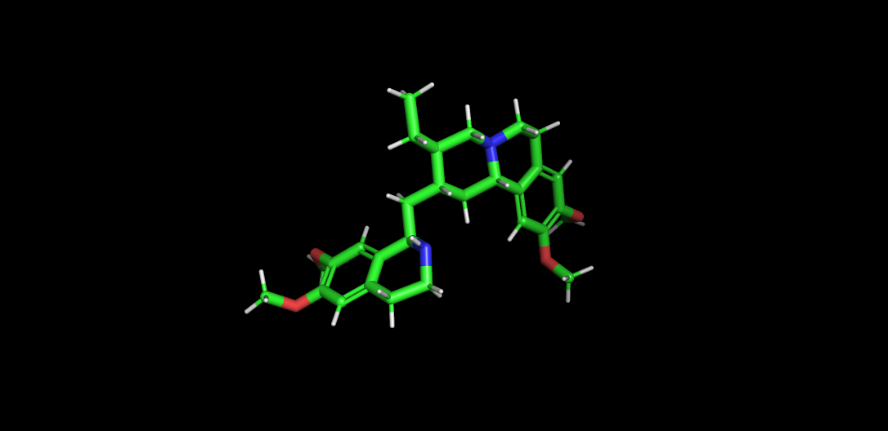
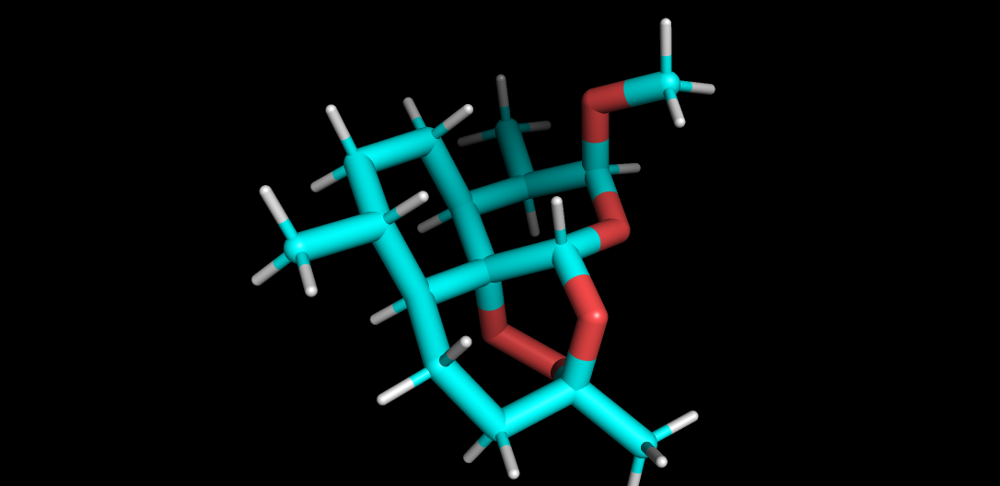
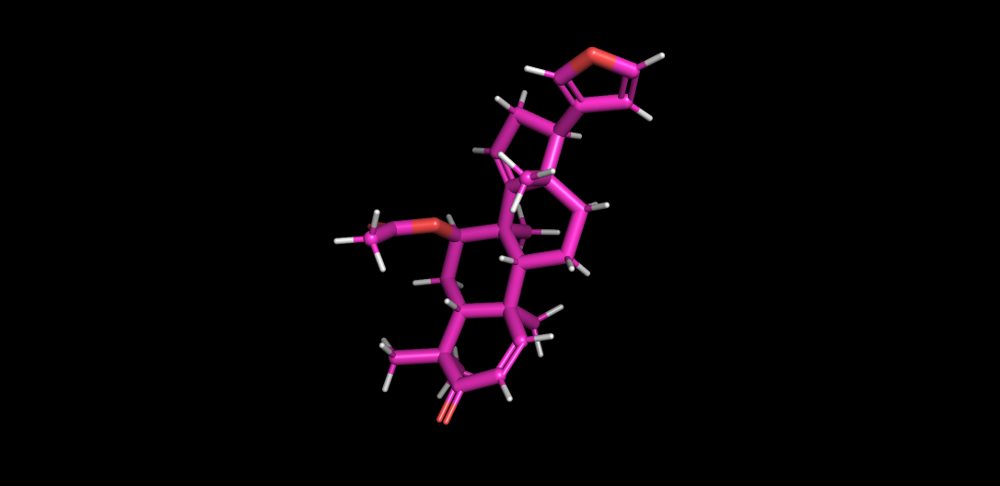
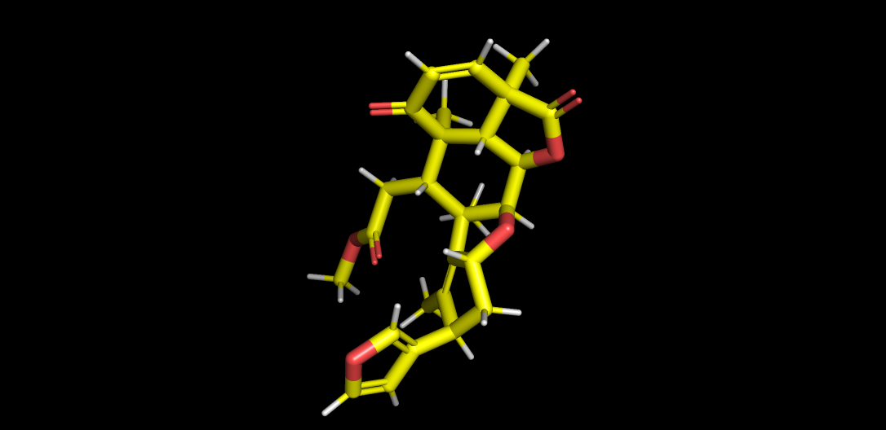
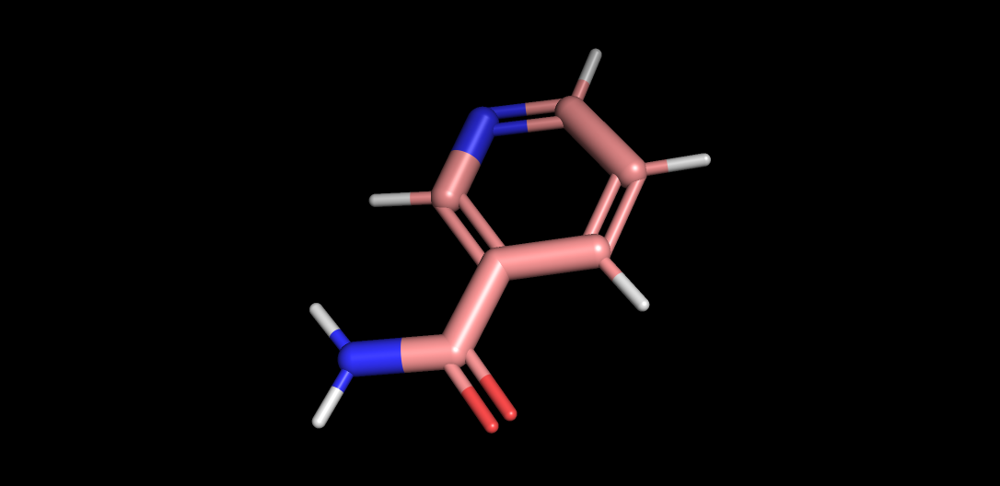
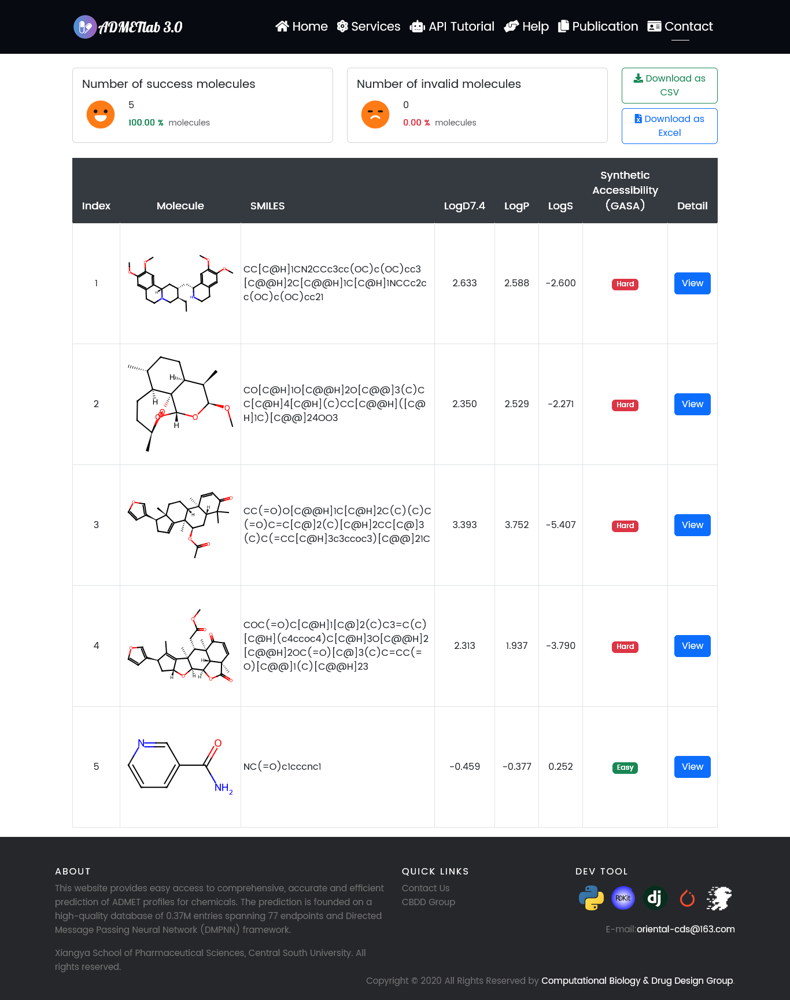

# allosteric-egfr-inhibitor-discovery

An in silico structure-based drug design pipeline screening natural compounds as allosteric inhibitors against drug-resistant mutant EGFR (PDB: 8TO4).

## Summary

This repository contains the data, outputs and figures of a capstone project completed for The Insilico Lab's three-week virtual training in computer-aided drug design. The target is the epidermal growth factor receptor carrying the T790M/V948R double mutation, crystallised with the allosteric inhibitor FRF-06-057 (PDB 8TO4, X-ray diffraction, 2.99 Å, four chains). Five compounds were taken through a common early-stage workflow: Emetine, Artemether, Azadirone, Nimbolide and Nicotinamide.

The workflow had five stages: drug-likeness screening of the ligands, preparation of the receptor, prediction of its binding pockets, ADMET profiling of the ligands, and an AlphaFold3 reconstruction of the receptor that was compared with the experimental structure. All five ligands satisfy Lipinski's Rule of Five. The largest pocket on chain D has a volume of 1330 Å^3 and a druggability score of 0.81, and the AlphaFold3 model reproduces the prepared crystal structure with an RMSD of 0.889 Å. Nicotinamide has the cleanest ADMET profile, whereas the larger natural products carry liver-injury or cardiac-liability flags.

## Tools used

Ligand identifiers and structures were obtained from PubChem, and drug-likeness was assessed with SwissADME. The receptor was downloaded from RCSB PDB and cleaned with UCSF Chimera (Dock Prep). Pockets were predicted with DoGSiteScorer on the proteins.plus server. ADMET endpoints came from ADMETlab 3.0, the receptor sequence was folded with the AlphaFold Server (AlphaFold3), and all structural visualisation and alignment was done in PyMOL. Everything was run through web servers or desktop applications, so no custom code is included.

## File structure

```
.
├── data/
│   ├── raw/
│   │   ├── 8TO4.pdb                       original coordinates from RCSB
│   │   ├── rcsb_pdb_8TO4.fasta            receptor sequence
│   │   ├── *_Conformer3D_COMPOUND_CID_*.sdf   ligand structures from PubChem
│   │   ├── ADMETLab3 Output/              prediction table (csv, xlsx)
│   │   └── DoGSiteScorer Output/          pocket descriptors, pocket grids, pocket residues
│   └── prepared/
│       ├── 8TO4_prepared.pdb              chain D, waters and heteroatoms removed, hydrogens and charges added
│       └── alphafold3_output/             AlphaFold3 model (cif) and the full download
├── results/
│   ├── swissadme/                         per-ligand screenshots and the screening table (csv)
│   ├── admetlab/                          per-ligand ADMET profiles and a batch summary
│   └── figures/                           PyMOL renders and server screenshots used below
└── scripts/                               reserved for future docking scripts
```

## Procedure

### 1. Drug-likeness screening

The five compounds were located in PubChem, and their CIDs and isomeric SMILES were recorded. The SMILES were submitted together to SwissADME, and molecular weight, hydrogen-bond donors and acceptors, and lipophilicity were compared against Lipinski's thresholds (MW up to 500 Da, up to 5 donors, up to 10 acceptors, LogP up to 5). The 3D conformers were downloaded from PubChem as SDF files and rendered in PyMOL.

| Compound | PubChem CID | MW (Da) | HBD | HBA | Consensus LogP | Lipinski violations |
| --- | --- | --- | --- | --- | --- | --- |
| Emetine | 10219 | 480.64 | 1 | 6 | 4.22 | 0 |
| Artemether | 68911 | 298.37 | 0 | 5 | 2.73 | 0 |
| Azadirone | 10906239 | 436.58 | 0 | 4 | 5.06 | 1 |
| Nimbolide | 12313376 | 466.52 | 0 | 7 | 3.11 | 0 |
| Nicotinamide | 936 | 122.12 | 1 | 2 | 0.10 | 0 |

Four compounds pass without any violation. Azadirone is the only borderline case: its consensus LogP of 5.06 sits just above the cut-off, and SwissADME records one violation. Because Lipinski's rule tolerates a single violation, Azadirone is still considered orally drug-like, but its high lipophilicity (and poor predicted solubility) made it a compound to watch in the later ADMET step.

<table>
<tr>
<td align="center"><br>Emetine</td>
<td align="center"><br>Artemether</td>
<td align="center"><br>Azadirone</td>
<td align="center"><br>Nimbolide</td>
<td align="center"><br>Nicotinamide</td>
</tr>
</table>

*Figure 1. PyMOL renders of the five ligands. The SwissADME result screenshots for each compound are in `results/swissadme/`.*

### 2. Protein preparation

The raw 8TO4 file contains four copies of the receptor (chains A to D), 70 crystallographic waters, and three kinds of bound heteroatoms: the ATP analogue ANP, a magnesium ion, and the allosteric inhibitor (residue name IXR). Chain D was kept and all other chains were deleted. Waters and all heteroatoms were then removed so that the pockets would be empty for later docking. Dock Prep in UCSF Chimera added hydrogens and assigned Gasteiger charges, and the result was saved as `8TO4_prepared.pdb`.

| Property | Value |
| --- | --- |
| Protein | EGFR (T790M/V948R) with allosteric inhibitor FRF-06-057 |
| Method and resolution | X-ray diffraction, 2.99 Å |
| Chains in raw file | A, B, C, D |
| Chain retained | D |
| Removed | other chains, 70 waters, ANP, Mg, IXR |
| Added | hydrogens, Gasteiger charges |

<table>
<tr>
<td align="center"><br>Raw 8TO4</td>
<td align="center"><br>Prepared chain D</td>
</tr>
</table>

*Figure 2. The structure before and after preparation, viewed in PyMOL.*

### 3. Binding site prediction

Pocket detection was run on the raw 8TO4 file, restricted to chain D, using DoGSiteScorer. The raw file was used on purpose, so that the prediction would not depend on any changes made during preparation. Eight pockets were found. Pocket P_0 stands clearly apart from the rest: its volume is 1330 Å^3 against 940 Å^3 for the second pocket and about 100 to 160 Å^3 for the remainder, and only P_0 and P_1 have drug scores of about 0.8 or higher.

| Pocket | Volume (Å^3) | Surface area (Å^2) | Depth (Å) | Simple score | Drug score |
| --- | --- | --- | --- | --- | --- |
| P_0 | 1330.37 | 1923.72 | 34.68 | 0.66 | 0.81 |
| P_1 | 939.90 | 1107.01 | 15.73 | 0.64 | 0.80 |
| P_2 | 156.99 | 233.00 | 11.93 | 0.00 | 0.41 |

P_0 is lined by 59 residues. Among them are several hydrophobic and aromatic residues, such as Leu730, Trp731, Phe795, Tyr801, Tyr813 and Trp817, together with charged and polar ones such as Arg705, Glu711, Asp770, Asn771, Arg776 and Gln791. This mixed, largely hydrophobic environment is consistent with an allosteric site that accommodates an inhibitor like FRF-06-057. The residue list is stored in `data/raw/DoGSiteScorer Output/residues/`, and it is the basis for choosing the centre and size of a docking grid.

<table>
<tr>
<td align="center"><br>DoGSiteScorer result page</td>
<td align="center"><br>Pocket P_0 surface in PyMOL</td>
</tr>
</table>

*Figure 3. Predicted pockets on chain D and the surface of the top-ranked pocket.*

### 4. ADMET prediction

The SMILES of all five ligands were submitted to ADMETlab 3.0 and the full table was downloaded (`data/raw/ADMETLab3 Output/`). Two representative endpoints were taken from each of the five ADMET categories. Caco-2 is given as log permeability, plasma protein binding in percent, and clearance in mL/min/kg. The remaining endpoints, except half-life, are the probabilities reported by ADMETlab.

| Endpoint | Emetine | Artemether | Azadirone | Nimbolide | Nicotinamide |
| --- | --- | --- | --- | --- | --- |
| Caco-2 permeability | -5.02 | -4.85 | -4.95 | -4.99 | -4.40 |
| Intestinal absorption (HIA) | 0.0004 | 0.0018 | 0.0040 | 0.0013 | 0.0006 |
| Blood-brain barrier (BBB) | 0.000001 | 0.0019 | 0.536 | 0.151 | 0.811 |
| Plasma protein binding | 71.0 | 60.3 | 94.0 | 93.1 | 4.7 |
| CYP1A2 inhibitor | 0.000003 | 0.317 | 0.003 | 0.050 | 0.002 |
| CYP3A4 inhibitor | 0.055 | 0.009 | 0.780 | 0.973 | 0.018 |
| Half-life | 1.90 | 1.92 | 0.27 | 1.19 | 2.08 |
| Clearance | 10.7 | 13.9 | 9.9 | 11.6 | 5.4 |
| hERG inhibition | 0.733 | 0.228 | 0.248 | 0.210 | 0.168 |
| Liver injury (DILI) | 0.112 | 0.725 | 0.836 | 0.845 | 0.607 |



*Figure 4. ADMETlab 3.0 batch result for the five ligands. Individual profile plots are in `results/admetlab/`.*

Absorption looks acceptable for all compounds, and SwissADME also predicts high gastrointestinal absorption for each of them. The compounds separate mainly on safety endpoints. Emetine is the only one with a high hERG probability (0.73), which signals cardiac liability, although its predicted liver-injury risk is low. Artemether, Azadirone and Nimbolide all have DILI probabilities of about 0.72 to 0.85, and Azadirone and Nimbolide are also strong CYP3A4 inhibitors, which raises the risk of drug-drug interactions. Azadirone additionally has a very short predicted half-life and high protein binding. Nicotinamide has the most favourable overall profile: low protein binding, low clearance, the longest half-life, and a low hERG probability, with a moderate DILI value of 0.61. The two predictors disagree on BBB permeation for several compounds (for example, SwissADME marks Emetine as permeant while ADMETlab gives it a probability near zero), so this endpoint should be treated with caution.

### 5. AlphaFold3 structure evaluation

The receptor sequence (`data/raw/rcsb_pdb_8TO4.fasta`) was submitted to the AlphaFold Server, and the best model (`fold_egfr_mutant_8to4_model_0.cif`) was downloaded. In PyMOL, the predicted structure was aligned onto `8TO4_prepared.pdb` with the `align` command. The overlay gave an RMSD of 0.889 Å over 2289 aligned atoms, which falls well within the range normally taken to indicate excellent agreement (below 2 Å).

| Metric | Value |
| --- | --- |
| RMSD | 0.889 Å |
| Aligned atoms (as reported by PyMOL) | 2289 |
| Predicted model | `fold_egfr_mutant_8to4_model_0.cif` |
| Reference | `8TO4_prepared.pdb` (chain D) |
| Assessment | Excellent |

<table>
<tr>
<td align="center"><br>AlphaFold Server result</td>
<td align="center"><br>Predicted and experimental overlay</td>
</tr>
</table>

*Figure 5. The AlphaFold3 prediction and its superposition on the prepared crystal structure.*

The close match indicates that the predicted fold can stand in for the experimental one when no crystal structure of a given mutant is available, although the ligand-free prediction cannot by itself show how an allosteric pocket would reshape around a bound inhibitor.

## Conclusions

Within this limited screen, all five ligands are acceptable by Lipinski's rule, with Azadirone as the only borderline case, and Nicotinamide is the most benign candidate on predicted ADMET grounds. The larger natural products, which are structurally more plausible binders for a big hydrophobic allosteric cavity, come with predicted liver or cardiac risks that would need to be addressed by optimisation. The receptor was prepared cleanly, its most druggable pocket was identified and characterised, and an independent AI-predicted model agreed closely with the experimental structure.

## Author
7ahseeen<br>
Cohort 6, The Insilico Lab CADD training